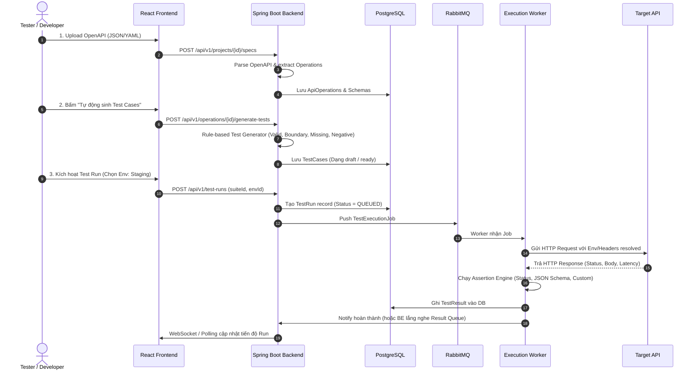

# Kiến trúc hệ thống (Architecture)

## 1. Mô hình tổng thể

Hệ thống được thiết kế theo mô hình **Modular Monolith** cho Core Backend kết hợp với **Worker Service riêng biệt** kết nối qua RabbitMQ để xử lý việc chạy test bất đồng bộ.

```text
                    React + TypeScript (Vite)
                              │  (REST / WebSocket)
                              ▼
                  Spring Boot Core Backend
                  (Port: 8080)
                  ├── Auth Module
                  ├── Project Module
                  ├── OpenAPI Ingestion & Parser
                  ├── Test Case Generator Engine
                  ├── Environment & Variables
                  ├── Test Run & Orchestrator
                  └── Report & Analytics
                              │
             ┌────────────────┴────────────────┐
             ▼                                 ▼
        PostgreSQL                         RabbitMQ
        (Data & JSONB)             (Exchange: test.exchange)
                                               │
                                               ▼ (Queue: test.execution.queue)
                                     Test Execution Worker
                                     (Port: 8081 / Headless)
                                     ├── Job Consumer
                                     ├── HTTP Execution Runner
                                     ├── Assertion Engine
                                     └── Concurrency / Rate Limiter
                                               │
                                               ▼
                                        Target REST API
```

---

## 2. Luồng dữ liệu (Data Pipeline)



---

## 3. Các quyết định kỹ thuật quan trọng (ADR)
1. **Dùng UUID v4 làm Primary Key**: Tránh xung đột ID khi scale, bảo mật hơn Auto-Increment ID.
2. **Dùng JSONB trong PostgreSQL**:
   - `request_template` (headers, query, body)
   - `expected_rules` (assertions, schemas)
   - `actual_response` (headers, body)
   Giúp cấu trúc dữ liệu cực kỳ linh hoạt mà không cần tạo hàng chục bảng EAV.
3. **Tách Worker riêng**: Việc thực thi hàng trăm HTTP request có thể mất vài phút. Nếu để chạy trực tiếp trong thread của Web Backend sẽ làm nghẽn Tomcat/HTTP connection pool. Worker riêng giúp kiểm soát concurrency và timeout độc lập.
